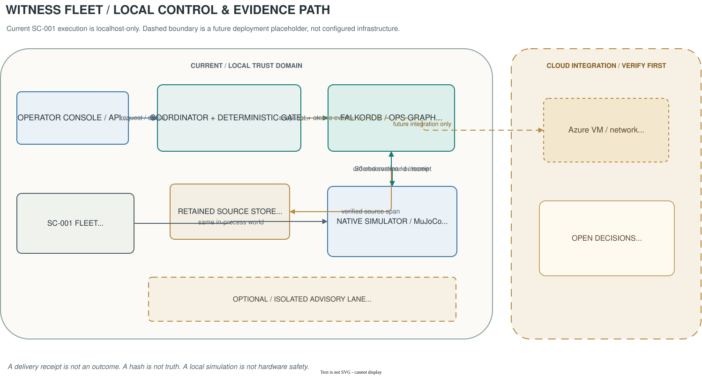
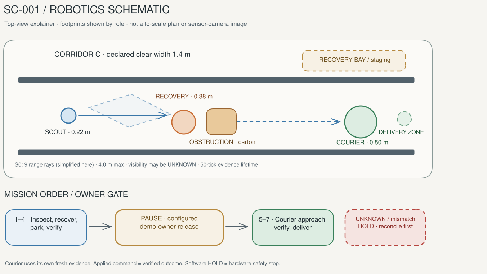
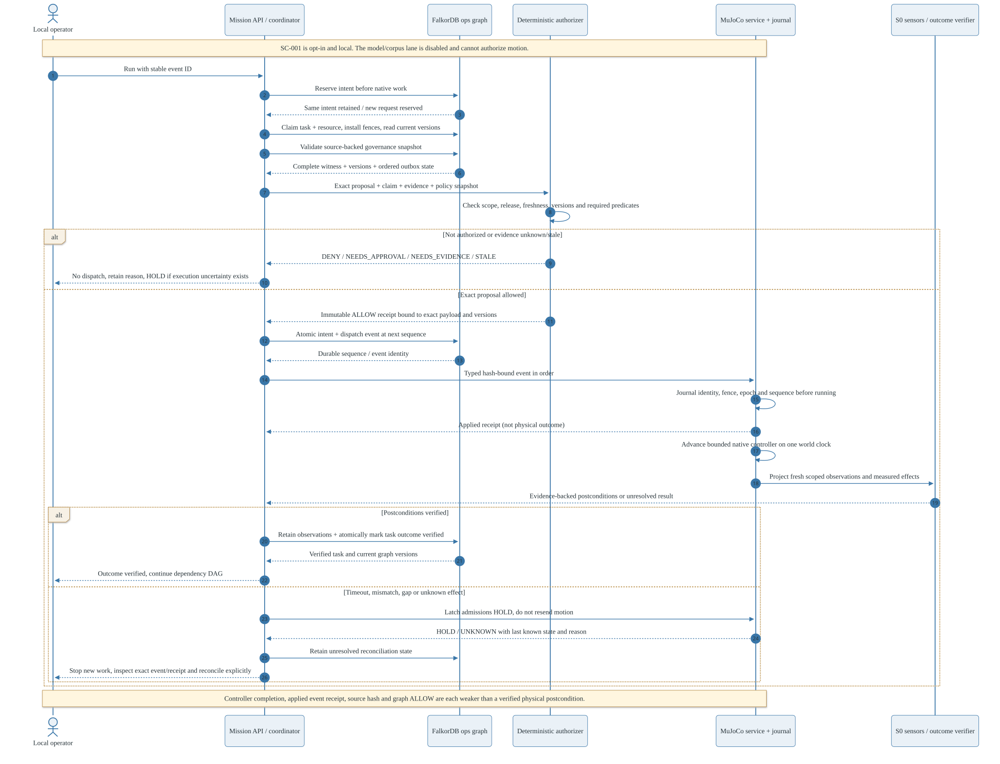

# Witness Fleet

## Evidence before motion.

**A corridor can be physically clear—and still forbidden.** Witness Fleet puts source-backed authority, fresh physical evidence and verified outcomes into the control path of a three-robot simulation.

[Product site](https://witness-fleet.vercel.app) · [Simulation demo](https://witness-fleet-guglxni.eastus.cloudapp.azure.com/demo) · [Architecture](docs/guide/architecture.md) · [Judge guide](docs/submission/JUDGE_GUIDE.md)

> **Live simulation, not real hardware.** The Vercel site and Azure HTTPS demo are deployed. A real cloud run completed all seven tasks, recovery, explicit synthetic release and native delivery; request replay returned the same result. This is not a physical robot controller, human identity system or safety certification.



### The moment that matters

A scout observes a blocked corridor. A recovery robot clears the obstruction. The courier still waits. **Physical clearance is not company permission.** Only a source-backed configured demo-owner release, fresh courier sensing and deterministic authorization allow the loaded courier to proceed. Delivery is complete only when native observations substantiate the outcome.

## What is built

| Layer | What it does | What it does not claim |
|---|---|---|
| **FalkorDB authority graph** | Retains typed policy, source revisions/spans, claims, task dependencies and outcomes | A pretty graph alone does not authorize anything |
| **Deterministic authorizer** | Checks scope, authority, freshness, claims and dispatch identity | Language-model confidence cannot grant permission |
| **Native MuJoCo fleet** | Measures rays, poses, contacts, displacement, stability and payload placement | Primitive simulation geometry is not production robotics |
| **Durable command journal** | Preserves request identity and known/unknown outcomes across failures | No distributed exactly-once guarantee |
| **React operator console** | Shows actual state, witnesses and explicit local demo-owner gate | A configured owner is not authenticated human IAM |
| **Hosted simulation gateway** | Separate, bounded visitor simulation sessions and sanitized state | No public access to local operator APIs or hardware |

## Run the real local mission

Prerequisites: **Python 3.12+, uv, Node.js 24+, Docker, FFmpeg**. The native mission needs no cloud credentials or paid inference.

```bash
git clone https://github.com/guglxni/witness-fleet.git
cd witness-fleet
uv sync --frozen --extra dev --extra simulator
npm --prefix web ci
npm --prefix web run build
.venv/bin/witness-fleet doctor
.venv/bin/python -m scripts.run_local_mission \
  --run-dir /tmp/witness-fleet-new-run --port 8095
```

Open **http://127.0.0.1:8095**. Startup does not move robots. Select **Run tasks**, inspect the paused witness, explicitly submit the **local demo-owner release**, then select **Run tasks** again. The launcher allocates its own loopback FalkorDB server. On Ctrl-C it stops only that container and retains the volume and run directory. Use a fresh run directory for each demonstration; never reset retained evidence.

### Develop the product site

```bash
npm --prefix site ci
npm --prefix site run dev
# http://127.0.0.1:5185
npm --prefix site test
npm --prefix site run build
```

The site uses original Anatomy-guided robot diagrams, Vanta, GSAP and Lenis with accessible motion controls. Recorded native footage is identified separately from illustration.

## SC-001: a complete evidence path



1. **Observe** the obstruction with fresh scoped evidence.
2. **Recover** using bounded physical movement and measured clearance.
3. **Verify** that recovery actually changed the native scene.
4. **Wait** at the source-backed owner-release gate.
5. **Refresh** courier-owned sensing after release.
6. **Travel** only with fresh visible fit evidence and stable arrival.
7. **Deliver** and retain the native payload-placement result.

See the [exact seven-task manifest and mission walkthrough](docs/guide/sc-001-mission.md). Normal mission footage does not stage process-death recovery; restart and unknown-receipt HOLD behavior are tested separately.

## Failure behavior is part of the product



- Unknown transport outcome is **HOLD**, not permission to repeat the command.
- Request retries cannot silently advance to the next task.
- Stale policy, stale evidence and conflicting ownership fail closed.
- Recovery cannot clear a latch while the native or journal state still requires HOLD.
- Public visitors cannot choose graph names, command targets, owner identities or release IDs.

Read [security boundaries](docs/guide/security.md), [runtime contract](RUNTIME.md) and [failure modes](FAILURE_MODES.md).

## Verification

The full suite partitions core/native tests from the optional corpus SDK environment. Corpus installation uses the exact source revision below; it is not loaded into the robot control process.

```bash
git clone --filter=blob:none --no-checkout \
  https://github.com/FalkorDB/GraphRAG-SDK.git .research/vendor/FalkorDB--GraphRAG-SDK
git -C .research/vendor/FalkorDB--GraphRAG-SDK checkout --detach \
  35e67a0b27fdcc7f2c28508b09e86169851a8187
uv sync --frozen --project services/corpus
docker compose up -d --wait graph
.venv/bin/python scripts/test_all.py
npm --prefix web test
npm --prefix web run typecheck
npm --prefix web run build
npm --prefix web run test:e2e
```

The [Verification workflow](.github/workflows/verify.yml) runs tests against isolated databases. The [Azure deployment workflow](.github/workflows/deploy-azure.yml) consumes a successful tested revision using GitHub OIDC, pushes the image to ACR, deploys by digest and checks the public revision. Vercel builds `site/` from the connected GitHub repository. Consult the [actual Actions runs](https://github.com/guglxni/witness-fleet/actions) and [verification status](BUILD_STATUS.md); a configured workflow is not by itself a passed run.

## Read the system

| Start with | Go deeper |
|---|---|
| [Guide index](docs/guide/README.md) | [Architecture and ownership](docs/guide/architecture.md) |
| [SC-001 mission](docs/guide/sc-001-mission.md) | [Native simulation assumptions](docs/guide/simulation.md) |
| [Graph/evidence model](docs/guide/graph-model.md) | [Canonical schema](GRAPH_SCHEMA.md) |
| [Operator runbook](docs/guide/operations.md) | [Security and failure semantics](docs/guide/security.md) |
| [Evidence and verification](docs/guide/evidence.md) | [Deployment](docs/guide/deployment.md) |
| [Editable diagrams](docs/diagrams/README.md) | [Math and robotics](MATH.md), [robotics derivations](math/ROBOTICS.md) |
| [Product specification](prd.md) | [Requirements](REQUIREMENTS.md), [program design](PROGRAM_DESIGN.md) |
| [Research decisions](RESEARCH.md) | [Primary sources](SOURCES.md), [integration pins](INTEGRATIONS.md) |

Original specifications document a wider design space than the implemented SC-001 path. Optional unverified provider mapping remains disabled. No live model inference is required or claimed.

## Repository map

```text
src/witness_fleet/     graph, policy, planning, runtime, API and hosted gateway
services/simulator/   native MuJoCo world, controllers, sensors and durable journal
services/corpus/      isolated optional corpus SDK environment
web/                  local operator console
site/                 public product launch website
fixtures/             original synthetic policies and scenarios
tests/                unit, contract, integration, adversarial and native E2E
scripts/              setup, suite runner, capture and verification
deploy/azure/         Bicep infrastructure and VM deployment script
docs/guide/           source-grounded engineering guides
docs/diagrams/        editable draw.io, Mermaid, Excalidraw and rendered previews
```

## Media, licenses and publication

The finished **86-second, 1080p narrated film** uses HyperFrames, recorded native MuJoCo footage, an OpenDesign Motion excerpt and ElevenLabs Sarah. [Watch/download the film](site/public/media/launch.mp4), inspect [sanitized provenance](site/public/media/provenance.json), or edit the [HTML motion project](media/launch/README.md). Original diagrams are explanatory, not fabricated sensor output.

See [third-party notices](THIRD_PARTY.md) and [publication scope](PUBLICATION.md). FalkorDB server uses SSPL; GSAP uses its Standard License; ElevenLabs is a proprietary service. Do not label the entire stack OSI FOSS. Complete third-party papers/web captures, vendor clones, credentials, machine reports and retained databases are not redistributed.

**Agent instruction files:** the original protected-file consent timeout left `AGENTS.md`, `CLAUDE.md` and `SKILL.md` absent. They were not recreated under alternative names. The specifications are documentation, not a substitute for protected agent instructions.
