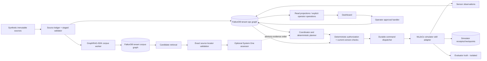

# Witness Fleet — Architecture

**Normative proposed design; not an implemented system.** Read `prd.md` first. This file supersedes earlier Graphiti-first sketches. Changes to authority, simulator boundary, schema or store ownership require an ADR and corresponding tests.

## 1. Selected stack and rationale

| Layer | Selected first-build path | Reason / boundary |
|---|---|---|
| Physical simulation | MuJoCo, original simple MJCF assets, Python single-step owner | Contact and geometry can invalidate recovery; no copied unlicensed warehouse stack |
| Agent/control | Python typed domain modules + deterministic state machine | Bounded inspect/travel/recover/verify/deliver/wait skills; no generated motor code |
| Canonical knowledge | FalkorDB + official Python client | Graph queries decide dependencies, evidence, permission inputs, eligible assignments and memory applicability |
| Company corpus | Separate GraphRAG-SDK-managed graph; typed source ledger in ops | One framework path; retrieval is discovery, not governance |
| Semantic decisions | Provider-neutral async HTTP adapter; Microsoft-Decision-1 first candidate | Optional evidence classification/reranking after graph retrieval; no motion authority |
| Local controller | Deterministic bounded controllers with stop/hold watchdog | No cloud in high-rate control; no formal physical safety certification |
| API / UI | FastAPI + typed HTTP/SSE; React/TypeScript/Vite dashboard | Browser receives projections, never database credentials or raw query privileges |
| Evidence artifacts | JSONL episode traces + immutable source files + manifests | Reproduction, not a competing full-state graph |
| Simulator receipts | Simulator-owned SQLite journal/checkpoints | External side-effect reconciliation, **not** an orchestration checkpoint or alternate authority store |

MuJoCo's official Python viewer documents a macOS `mjpython` requirement for passive-viewer main-thread rendering. Headless/interactive rendering must be probed on the actual host; the dependency is not installed by this spec.[83]

FalkorDB docs and the inspected v6.0.2 source differ on A*/CCH availability; neither is required. Retrieve eligible adjacency from FalkorDB and use a deterministic shortest-path solver on that bounded result. Do not maintain an authoritative full world graph beside FalkorDB.[17][18][58]

## 2. System diagram



There is **no** edge from a model response to authorization or actuation. The assessor can propose a choice from an already eligible set. The authorizer independently reevaluates all required predicates. The evaluator's truth cannot flow to the policy, even when the UI displays an explicitly labeled oracle overlay.

## 3. Schema ownership and graph names

- `wf:<tenant>:ops`: application-owned canonical graph; tenant is validated against an allowlist before graph name construction.
- `wf:<tenant>:corpus`: SDK-owned retrieval graph; SDK-created companion/ontology keys need an explicit discovered allowlist and separate ACL.
- No cross-graph Cypher or transaction is assumed. A promotion record copies checked IDs/text locators into ops through an idempotent application transition.
- Source bytes live in a content-addressed source directory; hashes and exact locators are in ops. Backup/restore covers both.
- Agents cannot call an unrestricted database query API. Read-only domain tools use allowlisted parameterized `GRAPH.RO_QUERY` templates. A separate writer has only the graph keys and commands it needs.

`GraphRAG.query()` uses a write-capable underlying query path; its deletion/merge behavior must never touch ops. Conditional source spans and fixed-size chunk offsets are useful but not an immutable approval/revision ledger.[62][63][79]

## 4. Component contracts and intended source layout

All paths below are **planned** files; only documentation/support validation exist in this package.

```text
src/witness_fleet/
  domain/{ids,events,observations,hypotheses,tasks,policies,decisions}.py
  graph/{client,migrations,queries,transitions,evidence,episodes}.py
  ingestion/{source_store,normalization,staging,promotion}.py
  policy/{scope,precedence,authorizer,approvals}.py
  planning/{frontier,assignment,routes,investigation,procedures}.py
  runtime/{coordinator,leases,dispatcher,reconciliation,clock}.py
  decisions/{contracts,projection,calibration,policy,cache}.py
  decisions/providers/{microsoft,typesafe,openai,structured_llm}.py
  simulation/{protocol,client}.py
  api/{app,schemas,reads,commands,stream}.py
services/corpus/{pyproject.toml,worker.py,sdk_adapter.py}
services/simulator/{pyproject.toml,server.py,world.py,sensors.py,skills.py,journal.py}
services/simulator/assets/{facility.xml,robots.xml}
web/src/{api,components,pages,theme}
fixtures/{sources,scenarios,policies,expected}
queries/{read,write,migrations}
eval/{split,run,metrics,report}.py
tests/{unit,contract,integration,simulation,adversarial,e2e}
```

- `GraphRepository`: exposes domain reads and tested conditional transitions; returns immutable typed DTOs and versions, not arbitrary live mutable graph objects.
- `SourceIngestor`: retains immutable bytes/text first, validates approved machine-readable policy rows, creates staged proposals, promotes only checked records.
- `Authorizer`: input `ActionProposal + current EvidenceBundle + current Claim`; output `ALLOW | DENY | NEEDS_EVIDENCE | NEEDS_APPROVAL | STALE`. All output carries structured reason codes and witness IDs.
- `Planner`: evaluates ready tasks and bounded admissible investigation actions; deterministic fallback always available. Output is a proposal, never a command.
- `Dispatcher`: accepts only a current authorization receipt bound to task/robot/policy/claim versions; writes intent then dispatches a stable command ID.
- `SimulatorAdapter`: returns observations and action receipts, rejects stale fences and duplicate command identities with different payloads, can be queried for an existing command.
- `DecisionProvider`: returns typed distributions/status, preserves provider metadata; cannot mutate policy or graph directly.
- `CorpusWorker`: communicates candidate IDs/passages through a small JSON HTTP contract, keeping incompatible SDK extras away from the runtime environment.

## 5. State and clocks

Keep `graph_version` (logical mutation revision), `policy_epoch` (governance-affecting changes), `task_version`, claim `fence`, `world_tick`, event timestamp, ingestion timestamp and policy-effective time separate. Integer ticks support deterministic simulation; the first-build policy-validity clock is explicitly `simulation_tick_v1` with source UTC intervals mapped once through the fixed episode epoch as specified in RUNTIME.md. UTC timestamps retain source/audit history; monotonic real-time deadlines support network/watchdog timeouts. Do not compare a wall-clock lease deadline with a simulation tick.

Each accepted transition increments the relevant counters in the same tested mutation. Observation ingestion increments graph revision but should not unnecessarily cancel unrelated tasks; use recorded dependency versions plus policy epoch for dispatch checks. For the first small fleet, conservative whole-policy invalidation is acceptable and measurable.

A multi-query evidence read is not automatically a consistent snapshot: prefer one bounded query returning necessary paths, or read graph version before/after the query bundle and retry on change. Before dispatch re-read relevant versions and acquire the command/claim transition. A last-moment policy update must win or invalidate the command; define ordering through the coordinator transition sequence and simulator dispatch receipt. In-flight policy changes trigger controlled cancellation/hold, not impossible time travel.

## 6. Main loop

1. Receive a sensor observation with pose/frame/tick, visibility, uncertainty, robot/payload scope and expiry.
2. Append evidence. Preserve contradictory observations; derive planning facts only under explicit rules.
3. Invalidate dependent permissions/tasks when supporting evidence expires or is refuted.
4. Query ready tasks, missing predicates, current restrictions, capable robots and reachable observation points.
5. Retrieve bounded related source spans/episodes. Validate all returned locators. Optional model ranks semantic evidence; governing restrictions are retrieved independently and completely.
6. Propose a permissible inspect/recover/reroute/wait action; hypotheses remain non-authoritative.
7. Run physical, operational and task/resource checks; claim atomically with expected versions.
8. Persist command intent and dispatch stable command ID/fence; local simulator checks fence, route reservation and immediate collision envelope.
9. Acknowledge separately from verified outcome. Obtain post-action evidence, transition task complete only when required effects are supported.
10. Requery dependent work. Any failure/refusal/unknown result enters a bounded recovery path, never success by default.

## 7. Coordination and persistence

Single coordinator initially, concurrent sensor/retrieval clients and independently raced claim clients in tests. This is centrally coordinated autonomy, not decentralized consensus.

The proposed claim mutation includes task ID/version, readiness, claim expiry under an explicit server/coordinator clock policy, required resource IDs, policy epoch and a new monotonically increasing fence. It must have exactly one winner under a barrier-synchronized race on the pinned database. If the conditional transition is not safely expressible/tested, **do not fake a CAS guarantee**: restrict dispatch to one writer and mark multi-writer acceptance unmet until fixed.

Docs describe atomic graph queries and serialized writes; Redis `MULTI/EXEC` does not roll back prior successful commands after an execution-time failure. Multi-step actions therefore use persisted states and reconciliation.[6][31]

For the demo, prefer explicit AOF with `appendfsync always` and a named persistent data volume; test actual selected image/configuration and latency. Record weaker `everysec` profiles separately with their admitted loss window. Process restart, container recreation and backup restore are distinct tests. Never modify/delete the earlier `graphhacks-fdb` container or volume implicitly.[11][12]

The simulator is a separate side-effect system. Its receipt ledger is keyed by command ID; acknowledgement of completion requires a durable receipt/checkpoint or an explicit weaker durability label. After ambiguous simulator crash it returns `UNKNOWN`, which keeps the task held until physical reinspection/reconciliation. No cross-store atomicity or physical exactly-once claim.

## 8. Model and SDK failure containment

- Missing/refused/malformed/late model result: deterministic ranking/investigation or operator review; not fabricated distributions.
- SDK outage: retain canonical sources and pending projection IDs, retry idempotently; direct typed ingestion still works with SDK-disabled status visible.
- Graph outage: no new coordinated command; local stop/hold and previously bounded safe stopping remain operational.
- Network timeout after graph write or command send: outcome is unknown; read the exact event/command identity, do not assume failure.
- Stale assessment: reject using snapshot/question/policy versions; cached opinions never outlive relevant evidence.

## 9. Deployment envelope

Start with local isolated services and no internet-facing control endpoint. CPU MuJoCo, FalkorDB in Docker, Python services and a dashboard are the target. Do not require CUDA, Isaac Sim, ROS/Open-RMF, a VLA, Kubernetes or a vector database on the critical path. Version locks and host support are verified during PLAN gates; upstream source inspection is not an installation smoke test.

## 10. Trace and causal proof

Every action trace records evidence IDs, applicable restriction set, excluded robot/task reasons, query template/version, graph/policy versions, model family/status if used, claim/fence, command ID, controller ack, post-observation and final outcome. A read projection assembles the witness **from canonical graph edges**, not from model prose.

Two causal tests are mandatory: changing the governing restriction changes the selected action while geometry stays constant; changing physical clearance changes action while policy stays constant. Removing FalkorDB halts normal coordination safely. An equal-information non-graph baseline remains useful for algorithmic comparison; database centrality is not proof other data structures are mathematically incapable.

## 11. Architectural decisions

See `ADRS.md` for simulator choice, graph/schema ownership, optional model activation, SDK isolation, no second memory framework, durable command semantics and staged product scope. `GRAPH_SCHEMA.md`, `DECISION_CONTRACTS.md`, `SIMULATION.md`, `SECURITY.md` and `EVALUATION.md` refine this architecture without replacing its authority separation.

<!-- GENERATED CITATION REFERENCES -->

## Sources

[6] https://docs.falkordb.com/design/concurrency.md — Atomicity and Concurrency Control in FalkorDB
[11] https://docs.falkordb.com/operations/durability/index.md — FalkorDB Durability and Data Persistence Guide
[12] https://docs.falkordb.com/operations/durability/persistence.md — Configuring RDB & AOF Data Persistence in Docker
[17] https://docs.falkordb.com/algorithms/astar.md — algo.AStar
[18] https://docs.falkordb.com/cypher/indexing/cch-index.md — CCH Indexing: Fast Point-to-Point Shortest Paths on Weighted Graphs
[31] https://redis.io/docs/latest/develop/using-commands/transactions — Transactions | Docs
[58] https://github.com/FalkorDB/FalkorDB/blob/7b7b4d1ed23fe78e69fa5da0c9e4f2ea2e73f3e9/graph/src/runtime/functions/procedures.rs — FalkorDB v6.0.2: graph/src/runtime/functions/procedures.rs
[62] https://github.com/FalkorDB/GraphRAG-SDK/blob/35e67a0b27fdcc7f2c28508b09e86169851a8187/graphrag_sdk/src/graphrag_sdk/api/main.py — GraphRAG SDK pinned: graphrag_sdk/src/graphrag_sdk/api/main.py
[63] https://github.com/FalkorDB/GraphRAG-SDK/blob/35e67a0b27fdcc7f2c28508b09e86169851a8187/graphrag_sdk/src/graphrag_sdk/core/connection.py — GraphRAG SDK pinned: graphrag_sdk/src/graphrag_sdk/core/connection.py
[79] https://github.com/FalkorDB/GraphRAG-SDK/blob/35e67a0b27fdcc7f2c28508b09e86169851a8187/graphrag_sdk/src/graphrag_sdk/ingestion/extraction_strategies/graph_extraction.py — GraphRAG SDK: span extraction and propagation
[83] https://mujoco.readthedocs.io/en/stable/python.html — Python - MuJoCo Documentation
