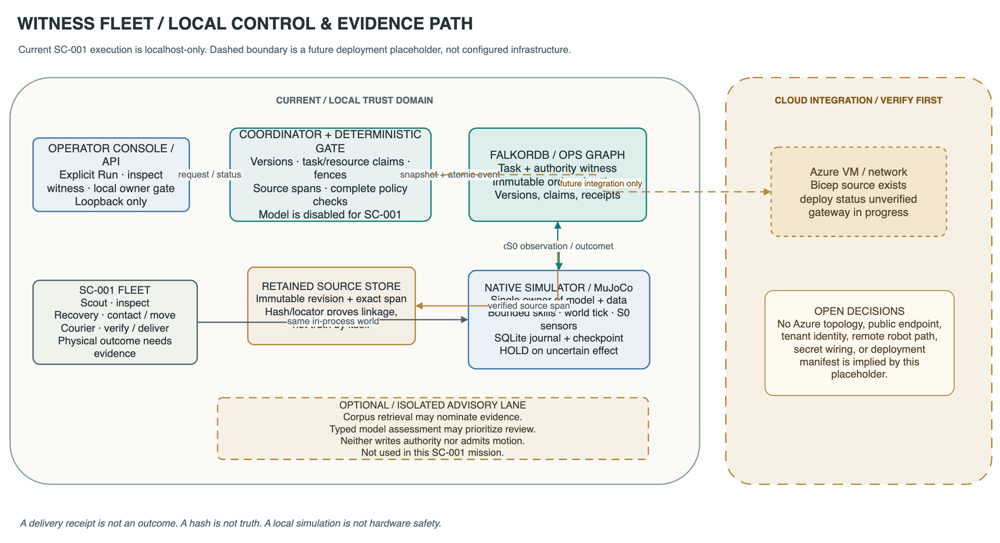

# Architecture and execution boundaries

## Design in one sentence

Witness Fleet makes robot actions conditional on current, source-backed graph authority and fresh physical evidence, while a single MuJoCo service owns world state and outcomes. The optional language-model/corpus research lane is advisory; it does not grant motion authority.

## Current executable topology

The editable source for this local-path diagram is [`system-boundaries.drawio`](../diagrams/system-boundaries.drawio). Its solid boundary describes local execution. The dashed cloud area is an earlier design placeholder, not the current hosting topology; use [deployment status](deployment.md) and [exact-revision evidence](deployment-evidence.md) for the hosted simulation.

### Components and ownership

| Component | Responsibility | Authority limit | Source |
|---|---|---|---|
| Operator UI/API | Displays a projection; receives explicit mission/hold/release requests | Browser-supplied actor, evidence, targets, and ALLOW are not trusted | [`api/mission.py`](../../src/witness_fleet/api/mission.py), [`runtime/mission.py`](../../src/witness_fleet/runtime/mission.py) |
| Mission controller/coordinator | Opt-in local workflow, retained episode identity, explicit synthetic owner action | Startup is inert; it does not silently release or resume unknown effects | [`runtime/mission.py`](../../src/witness_fleet/runtime/mission.py), [`runtime/coordinator.py`](../../src/witness_fleet/runtime/coordinator.py) |
| Deterministic authorizer | Checks claims, versions, evidence, complete governance witnesses and current scope | No graph/network/model call inside pure `authorize`; model text cannot override result | [`policy/authorizer.py`](../../src/witness_fleet/policy/authorizer.py), [`runtime/execution.py`](../../src/witness_fleet/runtime/execution.py) |
| FalkorDB operations graph | Retains tenant-scoped tasks, graph authority, immutable outbox/events and versions | Canonical control/evidence authority; an SDK/vector candidate is not a substitute | [`graph/store.py`](../../src/witness_fleet/graph/store.py), [`graph/governance.py`](../../src/witness_fleet/graph/governance.py) |
| Source store | Retains exact source bytes/text revisions and validates evidence spans | A hash/quote proves byte linkage, not truth or permission | [`ingestion/source_store.py`](../../src/witness_fleet/ingestion/source_store.py), [`graph/governance.py`](../../src/witness_fleet/graph/governance.py) |
| Native simulator | Owns MuJoCo model/data, advances one clock, executes bounded skills, records physical receipts | Simulator outcomes do not create policy permission; uncertain motion remains held/unknown | [`services/simulator/service.py`](../../services/simulator/service.py), [`world.py`](../../services/simulator/world.py), [`journal.py`](../../services/simulator/journal.py) |
| Optional corpus/model lane | Separate source retrieval and typed semantic assessment capability | **Not used by SC-001; model mode is disabled.** Advisory output cannot authorize action | [`DECISION_CONTRACTS.md`](../../DECISION_CONTRACTS.md), [`INTEGRATIONS.md`](../../INTEGRATIONS.md) |

### Command/evidence path

1. An explicit mission request starts a retained `mission-v2` SC-001 episode. The request ledger reserves an event identity before native work.
2. The coordinator acquires bounded ownership, claims the task/resource, installs fencing information, snapshots current versions, validates complete governance and builds an immutable proposal/authorization result.
3. A canonical command/outbox event is committed in the graph. The local adapter sends that typed event to simulator ingress; transport acknowledgment is not proof of the physical result.
4. MuJoCo advances bounded controller steps. Actual sensor/effect evidence is captured and retained; task completion requires an atomic verified outcome transition.
5. Unknown receipt, integrity/version mismatch, lost authority, stale evidence, or controller failure latches HOLD. There is no automatic retry of uncertain motion.

The executable sequence and HOLD branch are shown in [the command/evidence sequence diagram](../diagrams/command-evidence-sequence.svg) (editable [`command-evidence-sequence.mmd`](../diagrams/command-evidence-sequence.mmd)). See [`runtime/execution.py`](../../src/witness_fleet/runtime/execution.py), [`runtime/storage.py`](../../src/witness_fleet/runtime/storage.py), [`runtime/outcomes.py`](../../src/witness_fleet/runtime/outcomes.py), and [`services/simulator/journal.py`](../../services/simulator/journal.py).

## Authority is not one thing

- **Source provenance:** exact revision and span retained and round-tripped.
- **Governance:** typed permission/restriction/release records with explicit owner, scope, effective interval, approval and evidence links.
- **Physical state:** scoped sensor observations, freshness and uncertainty; `unknown` is not `clear`.
- **Claim/dispatch:** current task/resource lease/fences, versions and sequenced command identity.
- **Outcome:** evidence-backed postconditions, distinct from controller completion or an API response.

The deterministic authorizer requires compatible positive permission and checks all applicable restrictions. A release lifts only its named restriction in an equal-or-narrower scope. Current code validates the whole governance snapshot before authorization; do not mistake retrieval ranking, graph visualization, or model confidence for that check. See [graph model](graph-model.md) and [`policy/authorizer.py`](../../src/witness_fleet/policy/authorizer.py).

## Current deployment footprint vs. future design

The opt-in local mission launcher creates a uniquely named, loopback-published disposable FalkorDB container and a retained volume, then starts the app on loopback. The CLI creates an isolated graph namespace and retained source/simulator data beneath the selected new run directory. It does not run a public endpoint or require cloud services. A separate [`compose.yaml`](../../compose.yaml) defines local graph service profiles, but it is not the mission launcher's ephemeral container mechanism.

The bounded hosted simulation uses the separate [`hosting`](../../src/witness_fleet/hosting/__init__.py) gateway and [`Azure deployment`](../../deploy/azure/deploy-runtime.sh): Caddy terminates HTTPS and proxies the host-network application on `127.0.0.1:8080`; FalkorDB and session files are retained. [`main.bicep`](../../deploy/azure/main.bicep) describes the dedicated VM/network infrastructure. The public gateway exposes only bounded visitor-session routes, not the local operator API or hardware ingress. This is not a general production identity, managed-database, or physical-robot deployment. See [deployment status](deployment.md) and [exact-revision evidence](deployment-evidence.md), rather than treating an architecture diagram as proof of a live release.
